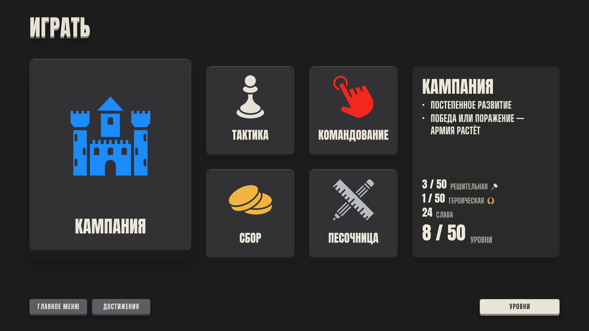
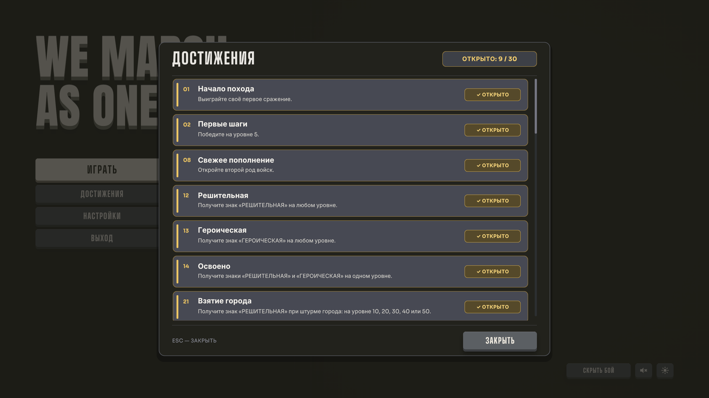

# We March as One: Русификатор

Русский перевод текста, шрифтов и всех достижений для **We March as One**.

**[Скачать WeMarchAsOne-RU-v1.1.zip](https://github.com/neoru-droid/we-march-as-one-ru/releases/latest)**

## Установка
1. Закройте игру, распакуйте архив и запустите `WeMarchAsOne-RU-Setup.exe` -> **«Установить русификатор»**.
2. **Steam Deck / Linux:** распакуйте архив и запустите `sh install-steamdeck.sh` рядом с `.exe`.
3. Кнопка **«Вернуть оригинал»** удаляет перевод. После обновлений игры запустите установку повторно.

*(Окно SmartScreen на Windows: «Подробнее» -> «Выполнить в любом случае».)*

## Скриншоты

| Главное меню | Выбор режима |
| :---: | :---: |
|  |  |

| Достижения | Древо навыков |
| :---: | :---: |
|  |  |

| Кампания | Установщик |
| :---: | :---: |
|  |  |

## Поддержать
- **[Boosty](https://boosty.to/cd_tixo)** (все релизы и выбор следующих игр)
- **[Чаевые через CloudTips (СБП / карта)](https://pay.cloudtips.ru/p/240b8760)**

Перевод сделан с помощью нейросети и проверен в игре. Найдёте опечатку или косяк - пишите в [Issues](https://github.com/neoru-droid/we-march-as-one-ru/issues), поправлю.

## Другие переводы
- [Frontier Tale](https://github.com/neoru-droid/frontier-tale-ru)
- [Zombies Aren't Real](https://github.com/neoru-droid/zombies-arent-real-ru)

Лицензия: [MIT](LICENSE) (шрифты в `fonts/` под SIL OFL 1.1)
