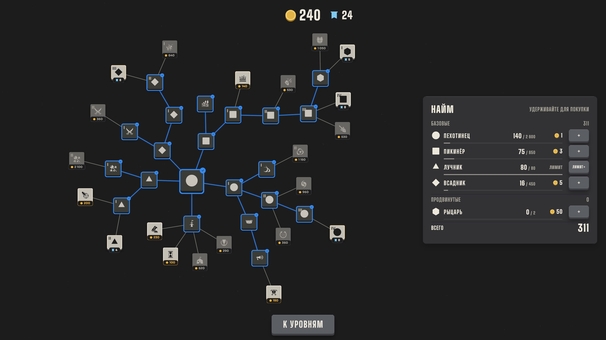
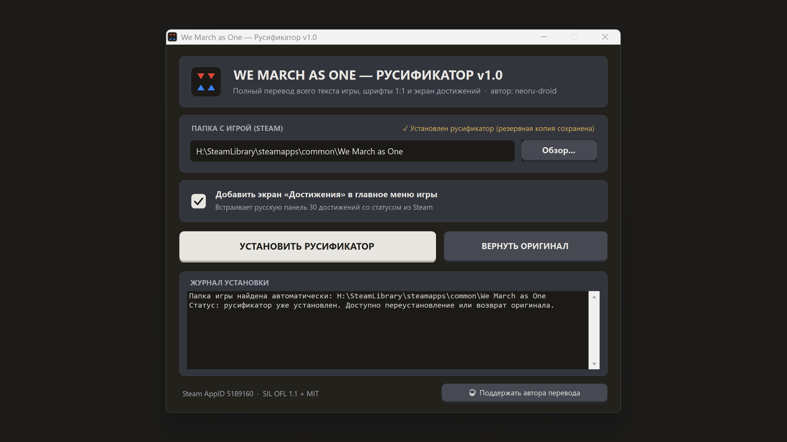

# We March as One: Русификатор

Полный русский перевод **We March as One**: весь текст игры (кампания, все режимы, древо навыков, войска, способности, обучение, песочница и редактор карт), 5 родных шрифтов с кириллицей, перевод достижений Steam и окно всех 30 достижений в меню (отключается при установке).

**[Скачать русификатор (WeMarchAsOne-RU-v1.1.zip)](https://github.com/neoru-droid/we-march-as-one-ru/releases/latest)**

## Установка

### Windows
1. Распакуйте `WeMarchAsOne-RU-v1.1.zip` в любую папку и закройте игру (для русского текста в уведомлениях о достижениях лучше полностью выйти из Steam через «Steam -> Выход»).
2. Запустите `WeMarchAsOne-RU-Setup.exe` и нажмите **«Установить русификатор»** (если игра лежит в `Program Files`, подтвердите запрос прав администратора).

*Про SmartScreen:* при первом запуске Windows может показать синее окно SmartScreen, так как у файла нет платной цифровой подписи. Нажмите **«Подробнее»** -> **«Выполнить в любом случае»**. Весь исходный код открыт и лежит здесь.

### Steam Deck / Linux
В режиме рабочего стола распакуйте архив и запустите `install-steamdeck.sh` двойным кликом или командой `sh install-steamdeck.sh` (`WeMarchAsOne-RU-Setup.exe` должен лежать рядом).

## Удаление и обновления
- Чтобы вернуть английскую версию, запустите `WeMarchAsOne-RU-Setup.exe` (или `install-steamdeck.sh`) и нажмите **«Вернуть оригинал»**.
- Если после обновления игры перевод слетит, просто запустите установку ещё раз.

## Скриншоты

| Главное меню | Выбор режима |
| :---: | :---: |
|  |  |

| Окно достижений | Древо навыков и найм |
| :---: | :---: |
|  |  |

| Кампания и выбор уровня | Программа установки |
| :---: | :---: |
|  |  |

## Состав репозитория
- `installer/`: исходный код установщика для Windows (`WeMarchAsOne-RU-Setup.exe`).
- `src/`: установщик и просмотр достижений для Steam Deck / Linux (`steamdeck_installer.py`).
- `mod/`: код окна достижений в меню игры.
- `fonts/`: шрифты игры с кириллицей.
- `translations/`: файлы с переводом.
- [`ACHIEVEMENTS_RU.md`](ACHIEVEMENTS_RU.md): список всех 30 достижений.

## Поддержать автора
Русификатор бесплатный. Если хочется сказать спасибо:
- **[Отправить чаевые через CloudTips (СБП / карта)](https://pay.cloudtips.ru/p/240b8760)**
- поставить звезду репозиторию на GitHub или оценить руководство в Steam.

В основе перевода нейросеть + ручная вычитка, словарь терминов и проверка в игре. Если заметите опечатку или неточность, пишите в Issues или в комментарии к руководству в Steam.

## Другие переводы
- **Zombies Aren't Real: Русификатор**: полный перевод текста, родной пиксельный шрифт 8x8 и окно 14 достижений ([руководство в Steam](https://steamcommunity.com/sharedfiles/filedetails/?id=3840725363) · [GitHub](https://github.com/neoru-droid/zombies-arent-real-ru)).

## Лицензии
- Код установщика, мода и текст перевода: [MIT](LICENSE); шрифты в `fonts/`: SIL Open Font License 1.1 (подробности в [`LICENSE`](LICENSE)).
- Неофициальный фанатский перевод (`neoru-droid`). Файлов самой игры в репозитории и архиве нет.
