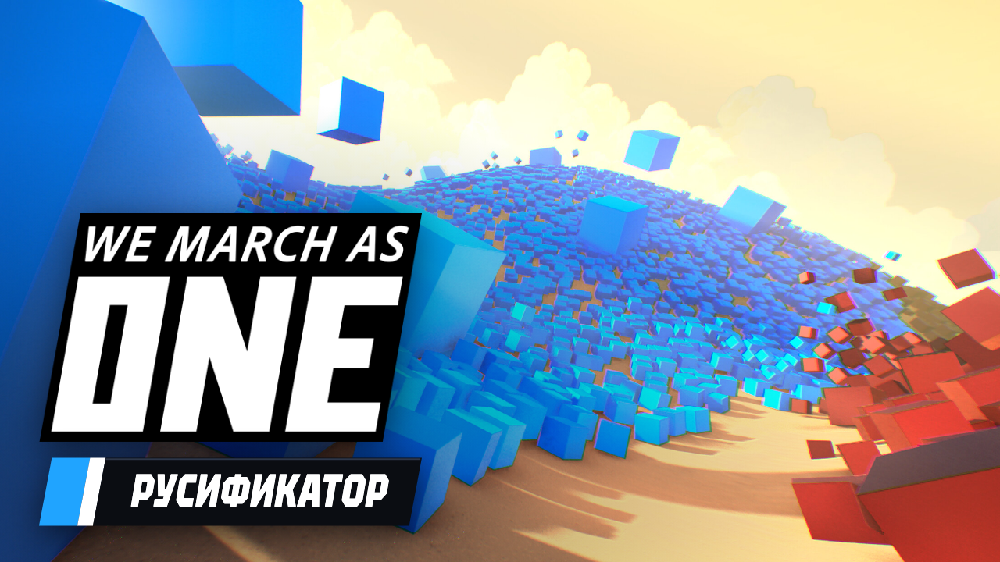
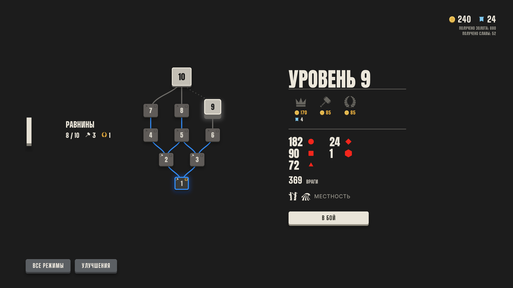

# We March as One - Русификатор

Кампания на 50 уровней, древо навыков, все 5 кириллических шрифтов и экран 30 достижений в меню игры (`v1.2`, сборка Steam `26651298`, Windows и Steam Deck).

## Скачать
**[Скачать русификатор v1.2 (ZIP)](https://github.com/neoru-droid/we-march-as-one-ru/releases/download/v1.2.0/WeMarchAsOne-RU-v1.2.zip)** · [Как установить](#установка) · [Руководство в Steam](https://steamcommunity.com/sharedfiles/filedetails/?id=3840161059)

## Установка
1. **Windows:** закройте игру, распакуйте архив и запустите `WeMarchAsOne-RU-Setup.exe` -> **«Установить русификатор»** *(при окне SmartScreen: «Подробнее» -> «Выполнить в любом случае»)*.
2. **Steam Deck / Linux:** распакуйте архив в одну папку и выполните `sh install-steamdeck.sh`.
3. **Откат:** кнопка **«Вернуть оригинал»** в том же установщике. После обновлений игры запустите установку повторно.

## Скриншоты

Открыть игровые кадры (5)

## Обновления
- **[v1.2](https://github.com/neoru-droid/we-march-as-one-ru/releases/tag/v1.2.0)** - уточнены подсказки навыков и песочницы, установщик различает установку и обновление.
- **[v1.1](https://github.com/neoru-droid/we-march-as-one-ru/releases/tag/v1.1.0)** - обновлённый установщик и поддержка Steam Deck.
- **[v1.0](https://github.com/neoru-droid/we-march-as-one-ru/releases/tag/v1.0.0)** - первый выпуск: 50 уровней, 5 шрифтов и экран 30 достижений.

Перевод сделан нейросетью и проверен в игре. Найдёте опечатку или косяк - пишите в [Issues](https://github.com/neoru-droid/we-march-as-one-ru/issues).

[Все переводы автора в Steam](https://steamcommunity.com/id/cd-_-TiXo/myworkshopfiles/?section=guides) · [Релизы](https://github.com/neoru-droid/we-march-as-one-ru/releases) · [MIT](LICENSE) (шрифты в `fonts/` под SIL OFL 1.1) · Автор: `neoru-droid`
