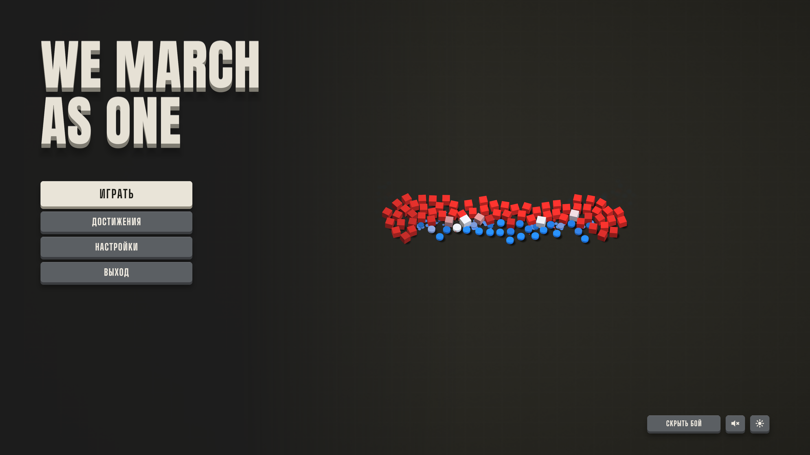

# We March as One: Русификатор

Полный русский перевод для тактической стратегии **We March as One**. Переведён весь текст в игре (кампания на 50 уровней, все режимы, древо навыков, войска, способности, обучение, песочница и редактор карт), во все 5 родных шрифтов добавлена кириллица, переведены уведомления Steam, а в главное меню по желанию добавляется кнопка со списком всех 30 достижений на русском языке.

**[Скачать русификатор (WeMarchAsOne-RU-v1.1.zip)](https://github.com/neoru-droid/we-march-as-one-ru/releases/latest)**

## Что входит в русификатор

- **Полный перевод игрового текста:** переведены все 1647 строк кампании, режимов «Тактика», «Командование» и «Сбор», древа навыков, обучения, песочницы, редактора карт, настроек и описаний всех войск.
- **Родные шрифты 1:1 с кириллицей:** русские буквы встроены прямо в 5 оригинальных шрифтов игры без подмены на чужеродные системные шрифты и без съехавшей вёрстки.
- **Экран «Достижения» и перевод в Steam:** переведены все 30 достижений в клиенте Steam, а в главное меню игры добавляется удобное русскоязычное окно достижений со статусом открытия (при желании отключается галочкой перед установкой).
- **Безопасность сохранений и обновлений:** прогресс кампании, облачные сохранения Steam Cloud и получение достижений работают штатно, а после патчей игры перевод аккуратно обновляется поверх новой версии.

## Как установить

### Windows

1. Скачайте архив `WeMarchAsOne-RU-v1.1.zip` и распакуйте его в любую папку.
2. Закройте игру (если хотите, чтобы всплывающие уведомления о новых достижениях в самом Steam сразу приходили на русском, перед установкой лучше полностью выйти из клиента через меню «Steam -> Выход»).
3. Запустите `WeMarchAsOne-RU-Setup.exe`. Папка с игрой обычно находится сама; если нет, укажите её кнопкой «Обзор...». Если кнопка «Достижения» в меню игры вам не нужна, снимите галочку перед установкой.
4. Нажмите **«Установить русификатор»** (если игра или клиент Steam установлены в `Program Files`, подтвердите запрос прав администратора Windows).

*Про SmartScreen:* при первом запуске Windows может показать синее окно защиты SmartScreen, так как у установщика нет платной цифровой подписи. Нажмите **«Подробнее»** и **«Выполнить в любом случае»**. Весь исходный код программы открыт и лежит в этом репозитории.

### Steam Deck и Linux (SteamOS)

В режиме рабочего стола распакуйте архив в любую папку и запустите `install-steamdeck.sh` двойным кликом или командой `sh install-steamdeck.sh` в терминале (файл `WeMarchAsOne-RU-Setup.exe` должен лежать рядом в той же папке). Откроется меню на русском языке с автопоиском игры во внутренней памяти и на карте microSD, установкой перевода, возвратом оригинала и просмотром вашего реального прогресса всех 30 достижений Steam.

## Удаление и обновления игры

- Чтобы вернуть исходные английские файлы игры, запустите `WeMarchAsOne-RU-Setup.exe` (или `install-steamdeck.sh` на Steam Deck / Linux) и выберите **«Вернуть оригинал»**. Программа восстановит чистые копии файлов из папки `ru_backup_orig` с проверкой контрольных сумм SHA-256.
- Если в Steam выйдет обновление игры и часть перевода сбросится, просто запустите установщик ещё раз и нажмите **«Установить русификатор»**.

## Скриншоты

| Главное меню | Выбор режима |
| :---: | :---: |
|  |  |

| Окно достижений | Древо навыков и найм |
| :---: | :---: |
|  |  |

| Кампания и выбор уровня | Программа установки |
| :---: | :---: |
|  |  |

## Что в репозитории

- `installer/`: исходный код однофайлового установщика для Windows на C# (`WeMarchAsOne-RU-Setup.exe`).
- `src/`: скрипт установки и просмотра достижений для Steam Deck и Linux (`steamdeck_installer.py`).
- `mod/`: код внутриигрового экрана достижений в главном меню.
- `fonts/`: генератор и 5 оригинальных шрифтов игры с добавленной кириллицей.
- `translations/`: файлы с переводом текста и достижений.
- [`ACHIEVEMENTS_RU.md`](ACHIEVEMENTS_RU.md): справочник всех 30 достижений на русском языке.

## Поддержать автора

Русификатор полностью бесплатный. Если перевод пригодился и хочется сказать спасибо:
- **[Отправить чаевые через CloudTips (СБП / карта)](https://pay.cloudtips.ru/p/240b8760)**
- поставить звезду этому репозиторию на GitHub или оценить руководство в Steam.

Перевод подготовлен с помощью нейросети, после чего вычитан по единому словарю терминов, подогнан под размеры интерфейса и проверен в игре. Если заметите неточность или опечатку, напишите в раздел Issues или в комментарии к руководству в Steam, поправим.

## Другие переводы автора

- **Zombies Aren't Real: Русификатор** - полный перевод текста, родной пиксельный шрифт 8x8 и окно 14 достижений ([руководство в Steam](https://steamcommunity.com/sharedfiles/filedetails/?id=3840725363) · [GitHub](https://github.com/neoru-droid/zombies-arent-real-ru)).

## Лицензии

- Код установщика, мода и текст перевода распространяются под лицензией [MIT](LICENSE), шрифты в папке `fonts/` распространяются под открытой лицензией SIL Open Font License 1.1 (подробности в файле [`LICENSE`](LICENSE)).
- Это неофициальный фанатский перевод (автор: [`neoru-droid`](https://github.com/neoru-droid)). Файлов самой игры в репозитории и в архиве релиза нет.
